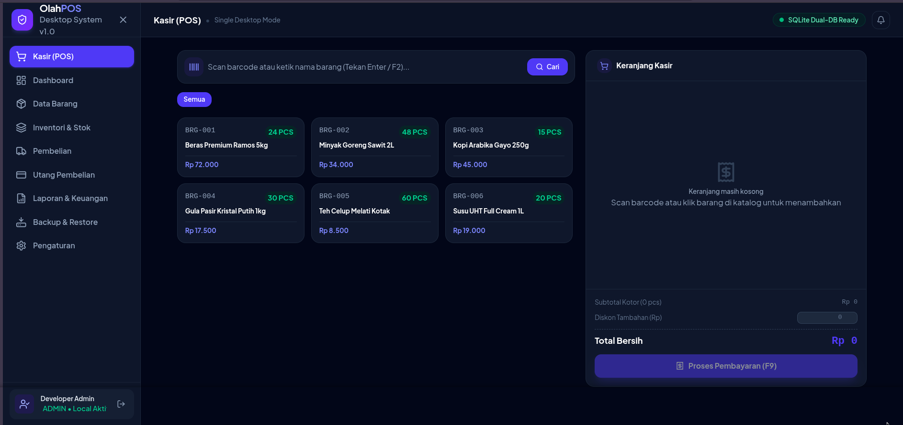
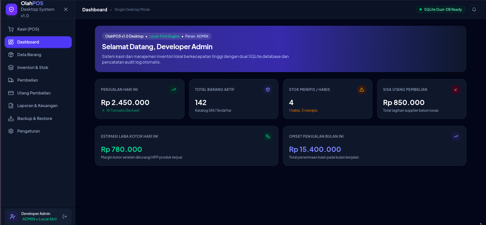
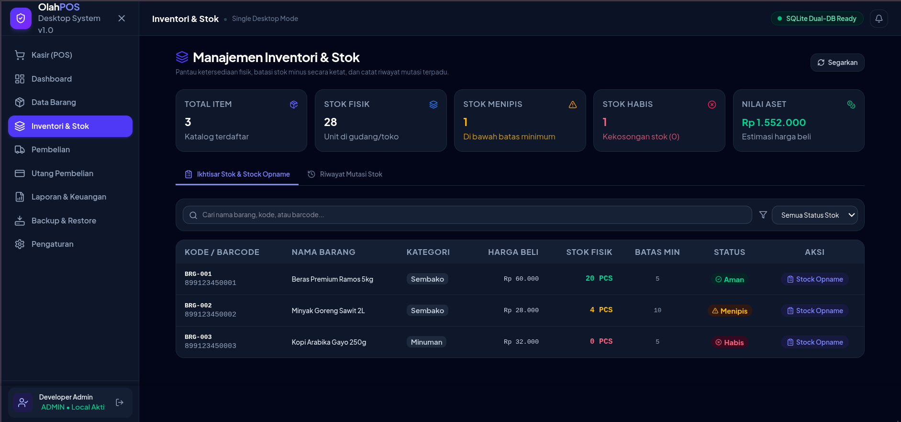
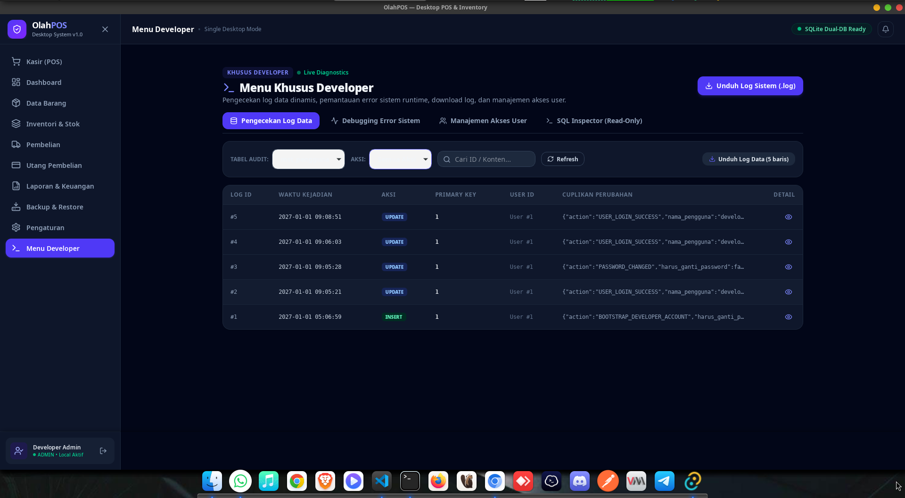
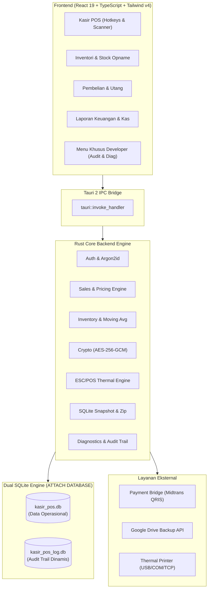

# 🛒 OlahPOS — Desktop Point of Sale & Inventory Management

<!-- Badges Header -->
[](https://tauri.app/)
[](https://www.rust-lang.org/)
[](https://react.dev/)
[](https://tailwindcss.com/)
[](https://www.sqlite.org/)
[](#-arsitektur-sistem)
[](#-prasyarat--panduan-instalasi)

**OlahPOS** adalah sistem aplikasi kasir (*Point of Sale*) dan manajemen inventori desktop modern dengan performa tinggi, dirancang khusus menggunakan pendekatan **Local-First** untuk pelaku usaha ritel, grosir, minimarket, toko, dan UMKM di Indonesia.

Seluruh data operasional utama disimpan dan diproses secara instan di komputer lokal pengguna menggunakan database **SQLite ganda berkecepatan tinggi**, sehingga kasir dapat tetap melayani transaksi secara penuh tanpa risiko terhenti ketika koneksi internet lambat atau terputus.

---

## 📸 Antarmuka Pengguna (Screenshots)

Berikut adalah tampilan antarmuka nyata dari sistem OlahPOS:

### 1. Layar Kasir & Transaksi POS
Layar kasir cepat yang responsif dengan dukungan scanner barcode instan, shortcut keyboard (`Enter`, `F2` pencarian barang, `F9` pembayaran), keranjang belanja dinamis, kalkulasi diskon otomatis, dan dukungan pembayaran Tunai maupun QRIS.


### 2. Dasbor Analitik & Ringkasan Bisnis
Ringkasan metrik eksekutif harian dan bulanan secara *real-time*: Omzet penjualan, estimasi laba kotor (margin HPP produk terjual), saldo sisa utang supplier, status stok menipis/habis, serta arus kas masuk dan keluar.


### 3. Manajemen Inventori & Mutasi Stok
Pemantauan ketersediaan stok fisik gudang/toko, estimasi total nilai aset persediaan, pembatasan stok minus secara ketat, stock opname terintegrasi, dan audit mutasi stok lengkap.


### 4. Menu Khusus Developer & Diagnostik Sistem
Panel internal eksklusif untuk pengembang (*developer only*) yang menyediakan pemantauan diagnostik live sistem, audit log perubahan data per tabel (`INSERT`, `UPDATE`, `DELETE`, `RESTORE`), pemantauan error runtime, ekspor/unduh log sistem (`.log`), manajemen hak akses pengguna, serta SQL Inspector (read-only).


---

## 🏛️ Arsitektur Sistem

OlahPOS dibangun di atas fondasi teknologi mutakhir untuk memberikan kecepatan native, penggunaan memori RAM rendah (< 50 MB), dan keandalan data maksimal:



### Keunggulan Desain Teknis:
1. **Dual SQLite Engine dengan `ATTACH DATABASE`**:
   - `kasir_pos.db`: Menyimpan data operasional bisnis (master barang, kategori, pembelian, penjualan, mutasi stok, utang, kas).
   - `kasir_pos_log.db`: Menyimpan audit trail lengkap perubahan tabel secara dinamis (`INSERT`, `UPDATE`, `DELETE`, `RESTORE`).
   - Diikat melalui perintah SQL `ATTACH DATABASE` dalam mode `WAL (Write-Ahead Logging)` sehingga setiap transaksi bisnis dan audit log dieksekusi dalam **satu transaksi atomik tunggal (100% ACID compliant)**. Tidak ada kemungkinan data bisnis tersimpan tanpa audit log atau sebaliknya.
2. **Kriptografi & Keamanan Berlapis**:
   - Kredensial integrasi pihak ketiga (Google OAuth Token, Midtrans Key) dienkripsi simetris menggunakan algoritma **AES-256-GCM** dengan *nonce* acak CSPRNG 96-bit dan enkripsi key 256-bit di `config.json` lokal.
   - Kata sandi pengguna diamankan dengan algoritma hashing mutakhir **Argon2id**.
   - Bootstrap akun developer aman bawaan dengan validasi izin akses ketat.
3. **Menu Developer & Audit Data Transparan**:
   - Seluruh mutasi bisnis terekam secara otomatis ke tabel dinamis di `kasir_pos_log.db`.
   - Developer dapat menelusuri snapshot data sebelum dan sesudah perubahan secara real-time.
   - Fitur inspeksi kesalahan runtime dan unduhan log terpadu memudahkan pemeliharaan dan audit teknis tanpa harus mengakses database secara manual di server.
4. **Mekanisme Backup Konsisten & OS-Native Scheduler**:
   - Snapshot database konsisten menggunakan perintah `VACUUM INTO` SQLite (mencegah korupsi data akibat backup saat penulisan aktif).
   - Kedua database dikompresi ke arsip `.tar.gz` dengan verifikasi *checksum* SHA-256 dan diunggah ke Google Drive.
   - Scheduler berjalan otomatis di latar belakang melalui mekanisme native OS (`systemd --user` timer di Linux dan `Windows Task Scheduler` di Windows) dengan fitur *catch-up execution* jika komputer baru menyala.
   - Retensi otomatis 10 arsip backup terverifikasi terbaru.
5. **Thermal Printer Engine Murni (ESC/POS)**:
   - Generator byte ESC/POS native di backend Rust mendukung format lebar 58mm dan 80mm.
   - Dukungan koneksi fleksibel melalui Raw USB, Serial COM port, maupun Network TCP port 9100.
6. **Payment Bridge Midtrans QRIS**:
   - Kunci server Midtrans tidak ditanam di desktop client. Transaksi QRIS diproses melalui Payment Bridge minimal dengan validasi status `settlement` resmi.

---

## ✨ Fitur Unggulan

| Modul | Deskripsi Fitur |
|---|---|
| **Kasir (POS)** | Pemindaian barcode cepat, shortcut keyboard (`F2` pencarian barang, `F9` pembayaran), keranjang belanja, diskon transaksi, pembayaran tunai & QRIS, cetak struk thermal otomatis. |
| **Katalog & Master Data** | Pengelolaan barang, kategori, satuan unit, supplier/kreditur, dan konfigurasi jenis mutasi stok dengan prefix tabel standar (`mst_` & `dat_`). |
| **Inventori & Mutasi Stok** | Pemantauan stok fisik *real-time*, batas peringatan stok minimum, pencegahan stok minus ketat, stock opname penyesuaian fisik, dan riwayat mutasi stok lengkap. |
| **Pembelian & Utang Supplier** | Pembelian tunai dan kredit (tempo), pencatatan uang muka (DP), penambahan stok instan saat penerimaan barang, serta pembayaran cicilan utang bertahap tanpa memengaruhi stok. |
| **Laporan & Arus Kas** | Pemisahan metrik akurat antara Omzet Penjualan, Harga Pokok Penjualan (HPP Moving Average), Estimasi Laba Kotor, Arus Kas Masuk Aktual, Arus Kas Keluar Aktual, dan Riwayat Utang. |
| **Dasbor Analitik** | Tampilan KPI visual kinerja toko hari ini dan bulan berjalan, grafik transaksi, peringatan barang menipis/habis, dan sisa kewajiban supplier. |
| **Backup & Restore Cloud** | Integrasi Google Drive API, snapshot otomatis terjadwal via OS scheduler, verifikasi integritas, retensi 10 snapshot, dan pemulihan database aman. |
| **Menu Khusus Developer** | Panel eksklusif developer: Pengecekan riwayat audit log dinamis per tabel, peninjauan error sistem runtime, unduhan berkas log (`.log`), SQL Inspector read-only, dan manajemen akses user. |


---

## 🚀 Prasyarat & Panduan Instalasi

### 1. Prasyarat Sistem
Pastikan perangkat Anda telah terpasang:
- **Node.js** v20+ atau **Bun** (direkomendasikan v1.2+)
- **Rust** & **Cargo** (MSRV 1.78+)
- **Paket Dependensi OS (Linux / Fedora / Ubuntu)**:
  - Fedora: `sudo dnf install webkit2gtk4.1-devel openssl-devel curl wget libappindicator-gtk3-devel librsvg2-devel dbus-devel`
  - Ubuntu/Debian: `sudo apt install libwebkit2gtk-4.1-dev build-essential curl wget libssl-dev libgtk-3-dev libayatana-appindicator3-dev librsvg2-dev libdbus-1-dev`
- **Windows**: [Build Tools for Visual Studio 2022](https://visualstudio.microsoft.com/visual-cpp-build-tools/) (C++ build tools) dan WebView2 runtime.

### 2. Instalasi Dependensi
Clone repositori dan pasang dependensi frontend:
```bash
git clone https://github.com/username/OLAH-POS.git
cd OLAH-POS

# Menggunakan Bun (rekomendasi)
bun install

# Atau menggunakan NPM
npm install
```

### 3. Menjalankan di Lingkungan Pengembangan (Development)
Untuk menjalankan frontend beserta jendela desktop Tauri:
```bash
# Menjalankan aplikasi desktop lengkap
bun run tauri dev
```
Untuk menjalankan frontend saja di browser (mode demo):
```bash
bun run dev
```

### 4. Menjalankan Pengujian (Verification & Tests)
```bash
# Pengujian tipe TypeScript
bun run typecheck

# Pengujian End-to-End Backend Rust (Dual SQLite & Lifecycle)
cd src-tauri
cargo test --test e2e_integration_test
```

### 5. Kompilasi Rilis Produksi (Production Build)
Untuk menghasilkan berkas instalasi desktop `.deb`, `.rpm`, `.AppImage` (Linux) atau installer `.msi`, `.exe` (Windows):
```bash
bun run tauri build
```
Hasil installer akan tersedia di direktori `src-tauri/target/release/bundle/`.

---

## 📄 Lisensi & Hak Cipta

Proyek ini dilisensikan di bawah **MIT License** [MIT](https://opensource.org). 

Artinya, Anda bebas menggunakan, mengubah, menyalin, menggabungkan, mempublikasikan, mendistribusikan, mensublisensikan, dan/atau menjual salinan perangkat lunak ini secara gratis, dengan syarat **menyertakan pemberitahuan hak cipta dan izin lisensi asli** di semua salinan atau bagian substansial dari perangkat lunak.

Lihat berkas [LICENSE](LICENSE) untuk informasi lebih lanjut.